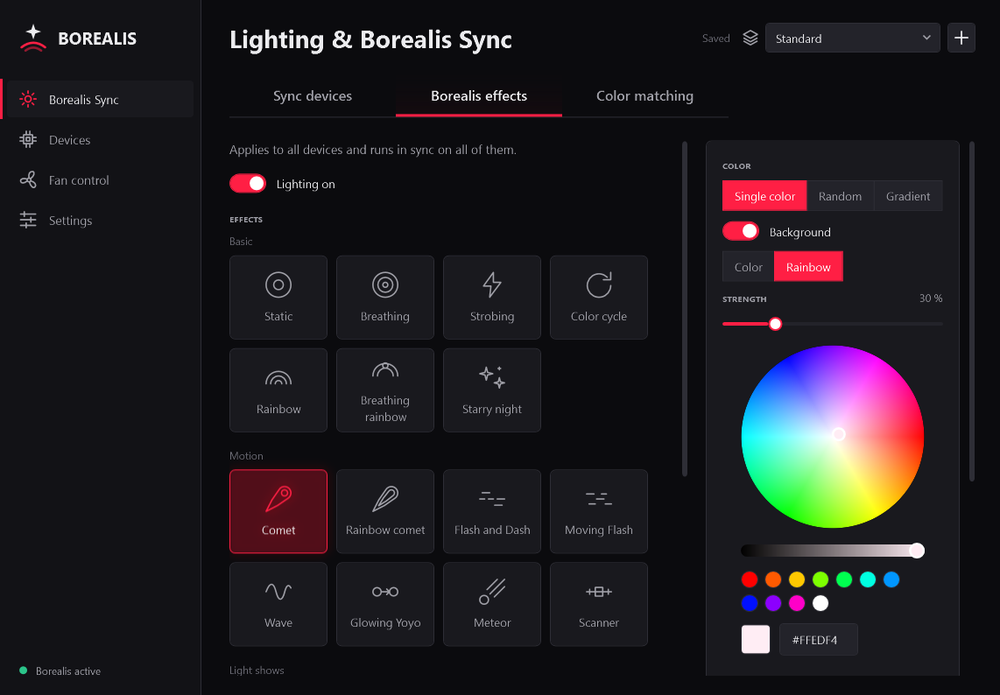
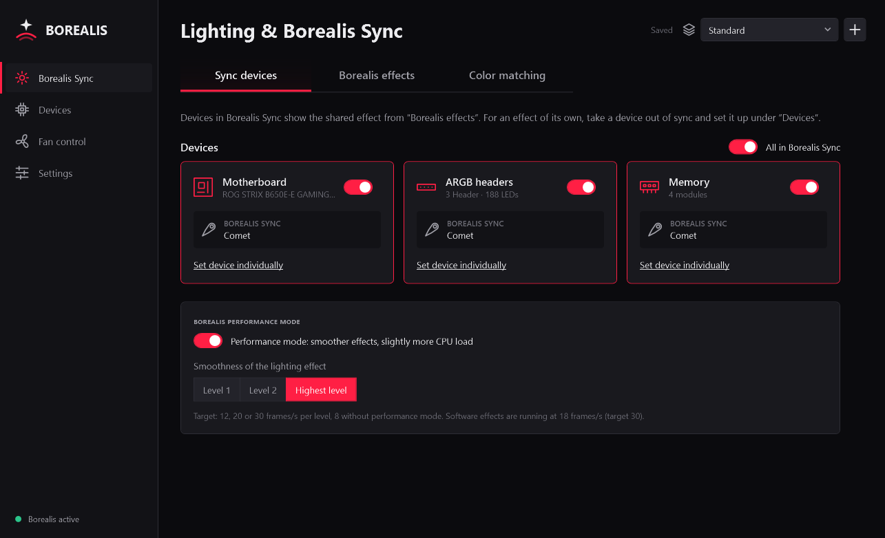
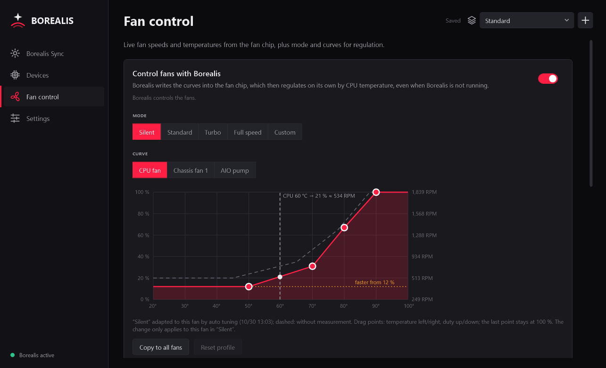
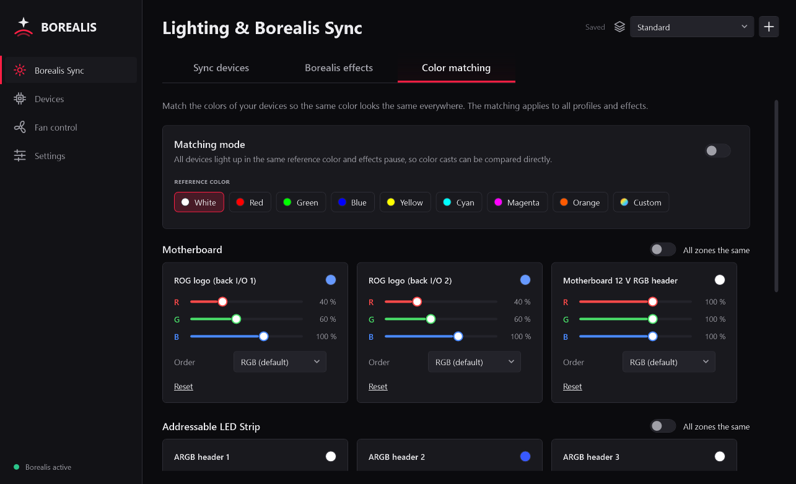

<h1 align="center">Borealis</h1>

Lighting and fan control for ASUS motherboards – lightweight, without Armoury Crate.

  
  
  
  

<b>English</b> · <a href="#deutsch">Deutsch</a>

---

Borealis replaces ASUS Armoury Crate for lighting and fans. A small tray app for settings and a Windows service that
does the work in the background – no ads, no account, no cloud.

<table>
  <tr>
    <td></td>
    <td></td>
    <td></td>
  </tr>
  <tr>
    <td align="center">Sync devices</td>
    <td align="center">Fan curves</td>
    <td align="center">Color matching</td>
  </tr>
</table>

## Features

- **Lighting:** motherboard zones, addressable ARGB headers and memory modules; firmware and custom software effects
  (e.g. comet, wave, fire, music, CPU/RAM load), shared sync or per-device settings, color matching, effect after
  shutdown, LED count per header.
- **Fans:** curves stored in the fan chip (they keep working when Borealis is not running), Silent/Standard/Turbo
  modes, custom curves per fan, temperature source per fan (CPU, motherboard or socket; the CPU fan always follows
  the CPU), auto tuning (measures speed, minimum and start-up duty of every fan and the AIO pump).
- **Sensors:** live fan speeds, CPU temperature (Tctl, CCDs), motherboard and socket temperature.
- **Other:** profiles with export/import, English/German, light/dark/system theme, start with Windows, optional daily
  check for new versions (asks GitHub only, downloads nothing).

## Tested hardware

| Part | Model |
|---|---|
| Motherboard | ASUS ROG STRIX B650E-E GAMING WIFI (AM5) |
| Fan chip | Nuvoton NCT6799D |
| Memory | DDR5 with ENE controller (firmware `AUDA0-E6K5-0101`) |
| CPU | AMD Ryzen 7000 (Zen 4) |

Other ASUS boards with the same USB lighting controller and Nuvoton chip will likely work fully or in part, but are
untested. Reports from other boards are welcome – see [CONTRIBUTING.md](docs/CONTRIBUTING.md).

## Installation

1. Download `Borealis-Setup-V<version>.zip` from the [releases](../../releases), extract it and run
   `Borealis-Setup-<version>.exe`.
2. Setup downloads the **.NET 10 Desktop Runtime** from Microsoft if needed and optionally sets up the
   **[PawnIO](https://pawnio.eu)** driver (needed for fans, temperatures and memory lighting).
3. Uninstall Armoury Crate first, or let Borealis turn off its services under Settings.

Requires Windows 10 (1809 or later) or 11, 64-bit.

## Building

- Install the [.NET 10 SDK](https://dotnet.microsoft.com/download).
- `setup\build.ps1` builds the app and service into `dist\Borealis`.
- `setup\build_installer.ps1` also builds the installer (requires [Inno Setup 7](https://jrsoftware.org/isinfo.php));
  `-CertThumbprint <thumbprint>` signs everything.

| Folder | Content |
|---|---|
| `src/Borealis.Core` | hardware access (USB HID, PawnIO, SMBus, Super I/O), effects, profiles |
| `src/Borealis.Service` | Windows service: lighting, fan control, sensors, named-pipe interface |
| `src/Borealis.App` | tray app (WPF) |
| `src/Borealis.Cli` | command line for testing |
| `setup` | build, installer and signing scripts |
| `docs` | [hardware reference](docs/hardware.md): USB lighting controller, fan chip, memory SMBus |

Code comments are in German for now.

## Safety and liability

Borealis writes fan curves to the Super I/O chip and colors to the memory controllers over SMBus. On the SMBus it only
talks to the ENE addresses 0x70–0x77, never to the modules' SPD hub or voltage regulator. Still: use at your own risk –
see the license, there is no warranty.

## Legal

Borealis is an independent project and is not affiliated with ASUSTeK Computer Inc. ASUS, ROG, Aura and Armoury Crate
are trademarks of ASUSTeK Computer Inc. Borealis contains and requires no ASUS software.

License: [GNU General Public License v3.0](LICENSE) (or later). Third-party components: see
[THIRD-PARTY-NOTICES.md](THIRD-PARTY-NOTICES.md).

---

## Deutsch

Borealis ersetzt für Beleuchtung und Lüfter die ASUS-Software Armoury Crate. Eine kleine Tray-App für die
Einstellungen, ein Windows-Dienst für die Arbeit im Hintergrund – keine Werbung, kein Konto, keine Cloud.
Bilder der Oberfläche siehe oben; die App gibt es auch auf Deutsch (Einstellungen → Sprache).

### Funktionen

- **Beleuchtung:** Mainboard-Zonen, adressierbare ARGB-Header und RAM-Module; Firmware- und eigene Software-Effekte
  (z. B. Komet, Welle, Feuer, Musik, CPU-/RAM-Last), gemeinsamer Sync oder Einstellung je Gerät, Farbabgleich,
  Effekt nach dem Herunterfahren, LED-Anzahl je Header.
- **Lüfter:** Kurven direkt im Lüfter-Chip (regeln auch, wenn Borealis nicht läuft), Modi Leise/Standard/Turbo,
  eigene Kurven je Lüfter, Temperaturquelle je Lüfter (CPU, Mainboard oder Sockel; der CPU-Lüfter regelt immer nach
  der CPU), Auto-Tuning (misst Drehzahl, Mindest- und Anlaufleistung jedes Lüfters und der AIO-Pumpe).
- **Sensoren:** Drehzahlen, CPU-Temperatur (Tctl, CCDs), Mainboard- und Sockeltemperatur live.
- **Sonstiges:** Profile mit Export/Import, Englisch/Deutsch, helles/dunkles/System-Farbschema, Start mit Windows,
  auf Wunsch tägliche Suche nach neuen Versionen (fragt nur GitHub, lädt nichts herunter).

### Getestete Hardware

Siehe [Tested hardware](#tested-hardware). Andere ASUS-Boards mit demselben USB-Beleuchtungscontroller und Nuvoton-Chip
funktionieren wahrscheinlich ganz oder teilweise, sind aber nicht getestet. Rückmeldungen gern, siehe [CONTRIBUTING.md](docs/CONTRIBUTING.md#mitmachen).

### Installation

1. `Borealis-Setup-V<Version>.zip` aus den [Releases](../../releases) laden, entpacken und
   `Borealis-Setup-<Version>.exe` ausführen.
2. Das Setup lädt bei Bedarf die **.NET 10 Desktop-Laufzeit** von Microsoft und richtet auf Wunsch den Treiber
   **[PawnIO](https://pawnio.eu)** ein (nötig für Lüfter, Temperaturen und RAM-Beleuchtung).
3. Armoury Crate vorher deinstallieren oder in Borealis unter Einstellungen dessen Dienste abschalten lassen.

Voraussetzung: Windows 10 (ab 1809) oder 11, 64 Bit.

### Selbst bauen

- [.NET 10 SDK](https://dotnet.microsoft.com/download) installieren.
- `setup\build.ps1` baut App und Dienst nach `dist\Borealis`.
- `setup\build_installer.ps1` baut zusätzlich den Installer (braucht [Inno Setup 7](https://jrsoftware.org/isinfo.php));
  mit `-CertThumbprint <Fingerabdruck>` wird alles signiert.

Ordnerübersicht siehe [Building](#building); die Hardware-Referenz gibt es auch auf Deutsch:
[docs/hardware.de.md](docs/hardware.de.md).

### Sicherheit und Haftung

Borealis schreibt Lüfterkurven in den Super-I/O-Chip und Farben über SMBus in die RAM-Controller. Auf dem SMBus
spricht es nur die ENE-Adressen 0x70–0x77 an, niemals SPD-Hub oder Spannungsregler der Module. Trotzdem gilt:
Benutzung auf eigene Gefahr – siehe Lizenz, es gibt keine Gewährleistung.

### Rechtliches

Borealis ist ein unabhängiges Projekt und steht in keiner Verbindung zu ASUSTeK Computer Inc. ASUS, ROG, Aura und
Armoury Crate sind Marken von ASUSTeK Computer Inc. Borealis enthält keine ASUS-Software und benötigt keine.

Lizenz: [GNU General Public License v3.0](LICENSE) (oder später). Fremde Bestandteile: siehe
[THIRD-PARTY-NOTICES.md](THIRD-PARTY-NOTICES.md).
